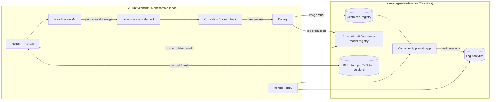

# Maintenance guide (MLOps runbook)

How to run, update, monitor and roll back the rooftop-solar detector. Everything below is done from GitHub
(Actions tab) or the Azure portal — no passwords or keys are stored anywhere: GitHub logs in to Azure with
OIDC as the managed identity `id-solar-github`, which only has rights inside `rg-solar-detector`.

## Architecture



| Piece | Where | What it does |
|---|---|---|
| Code, model, pipeline definition | GitHub repo | `dvc.yaml` (stages), `params.yaml` (settings), `dvc.lock` (exact data/code hashes of the current model) |
| Data versions | Azure Blob `stsolar99c8f7/dvc` | DVC remote: every dataset version, content-addressed |
| Experiment tracking | Azure ML `mlw-solar-detector` → **Jobs** | Every training as an MLflow run, with a child run per model compared |
| Model registry | Azure ML → **Models** → `solar-detector` | Versions v1, v2, …; tag `stage` = `candidate` / `production` / `archived`, plus `image_tag`, `git_sha`, `data_md5` |
| App images | Container Registry `acrsolar99c8f7` | `solar-detector:<short commit sha>` — every deployed version, for rollback |
| Live app | Container App `ca-solar` | Public HTTPS URL (in `infra/azure.env`), scales to zero when idle |
| Logs & monitoring | Log Analytics `log-solar-detector` | Container logs + one JSON line per prediction |

## Workflows (GitHub → Actions)

| Workflow | Runs | Does |
|---|---|---|
| **CI** | every push / PR | install pinned deps, 15 tests, build Docker image, container health check |
| **Deploy** | after CI passes on `main`, or manually | build image → push to registry → update Container App → check live URL → register model in Azure ML as `production` |
| **Retrain** | manually (inputs: trials, redownload) | `dvc pull` → `dvc repro` → tests → drift report → quality gate → MLflow run + `candidate` model → `dvc push` → branch `retrain/<n>` |
| **Monitor** | daily 08:00 Sri Lanka time, or manually | uptime check, running version, 7-day prediction summary |

## Common tasks

### Retrain the model
1. Actions → **Retrain** → *Run workflow* (default 10 Optuna trials; on GitHub's 2-core runners a run takes ~2–3 h).
2. Read the run summary: parameter diff, metric diff vs. the current model, drift table, quality gate.
   If the gate fails, the run stops and nothing changes.
3. Open the pull request from the link in the summary (`retrain/<n>` → `main`). CI runs on it.
4. Merge → **Deploy** runs automatically and tags the new version `production` in Azure ML.

### Change a setting (e.g. the export threshold or number of trials)
Edit `params.yaml`, then run **Retrain**. `dvc params diff` in the summary shows what changed.

### Roll back to an earlier version
1. Find the image tag of the good version: Azure ML → Models → `solar-detector` → version → tag `image_tag`
   (or Container Registry → Repositories → `solar-detector`).
2. Actions → **Deploy** → *Run workflow* → enter that tag. The app switches back without rebuilding.
3. To make the rollback permanent, revert the model commit on `main`.

### Check the app's health and usage
- Actions → **Monitor** → latest run summary, or run it manually.
- Azure portal → `log-solar-detector` → Logs:
  ```kusto
  ContainerAppConsoleLogs_CL
  | where Log_s has "\"event\": \"prediction\""
  | extend e = parse_json(Log_s)
  | summarize count() by bin(TimeGenerated, 1d), tostring(e.mode)
  ```

### Compare experiments
Azure ML studio (ml.azure.com) → workspace `mlw-solar-detector` → **Jobs** → experiment `solar-detector`
→ select runs → *Compare*. Each training run contains the 16 model runs as children, the explanations
(`explain/`) and the packaged model (`model/`).

### Work locally with the versioned data
```bash
az login                       # Azure CLI, once
pip install -r requirements.txt -r requirements-mlops.txt
dvc pull                       # fetch the exact dataset version recorded in dvc.lock
dvc repro                      # rerun only what changed
dvc metrics diff main          # compare with main
```
For tracking runs to Azure ML from your laptop, `export MLFLOW_TRACKING_URI=...` (value in `infra/azure.env`).

## Costs and clean-up
Azure for Students credit (US$100, expires 27/09/2027). Expected cost ≈ US$5–7/month, almost all of it the
Basic container registry; the app scales to zero, and the Azure ML workspace, storage and logs cost cents.
Check: Azure portal → **Cost Management** → Cost analysis, filtered to `rg-solar-detector`.

**Delete everything** (stops all charges; the GitHub repo and local files are not affected):
```bash
az group delete -n rg-solar-detector --yes
```
To recreate it later: run `infra/azure_setup.sh` in Cloud Shell and update `infra/azure.env`.

## If something breaks
| Symptom | Likely cause | Fix |
|---|---|---|
| Deploy fails at `azure/login` | Federated credential subject does not match | Repo/branch renamed? Re-run `infra/azure_setup.sh` with the new `REPO` |
| Deploy fails at health check | App crashed on start | Azure portal → `ca-solar` → Log stream; roll back to the last tag |
| First page load takes ~30 s | Scale-to-zero cold start | Expected; set min replicas to 1 (costs more) if needed |
| Retrain fails at "Get versioned data" | Kaggle blocked the download and no DVC copy exists | Run Retrain with `redownload` off after a successful `dvc push`, or `dvc push` from a laptop |
| Revision fails with "Authentication failed when pulling container image" | App's environment is in Express mode, or the registry identity is missing | Use a standard environment (`--enable-workload-profiles false`, as in `infra/azure_setup.sh`); `az containerapp registry set --identity <id-solar-app resource id>` |
| Quality gate fails | New model worse than current | Nothing to do — production is unchanged; inspect the run in Azure ML |
